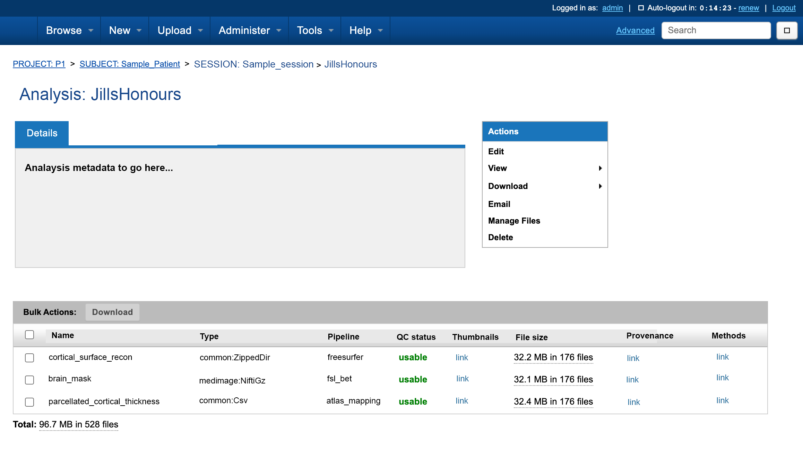

<!-- Diátaxis: explanation. Owner: James. Remove `draft: true` from the front matter when the page is ready to publish. -->

TODO: what dynamic assessor types are, why pipeline results are stored as assessors, and how they appear in XNAT (see the mock-up below).

